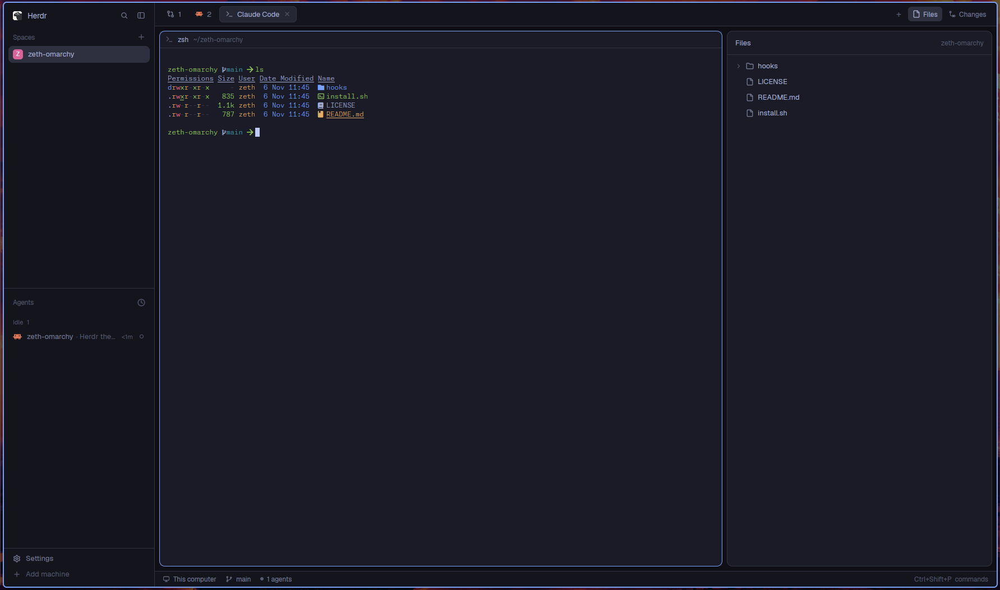

# herdr-theme

Makes the [Herdr app](https://herdr.dev) follow your Omarchy theme and terminal font.



On every `omarchy theme set` / `omarchy font set` it:

- reads the active theme's `colors.toml` and writes `~/.config/herdr-app/themes/omarchy.json`
  (terminal colors, 16 ANSI colors, sidebar/card/border/accent colors, agent status colors)
- sets `theme`, `font` and `appearance` (light/dark) in `~/.config/herdr-app/settings.json`

Other keys in `settings.json` are left alone. If Herdr isn't installed the hook exits quietly.

## Install

```sh
./install.sh herdr-theme
```

This symlinks the script into `~/.config/omarchy/hooks/theme-set.d/` and `font-set.d/` and runs it once.

## Notes

- It overwrites `font` and `appearance` in Herdr's `settings.json`. Edit the script if you want to keep your own.
- Herdr's in-app theme picker overrides this until the next Omarchy theme change.
- Requires `python3` (3.11+, for `tomllib`).
